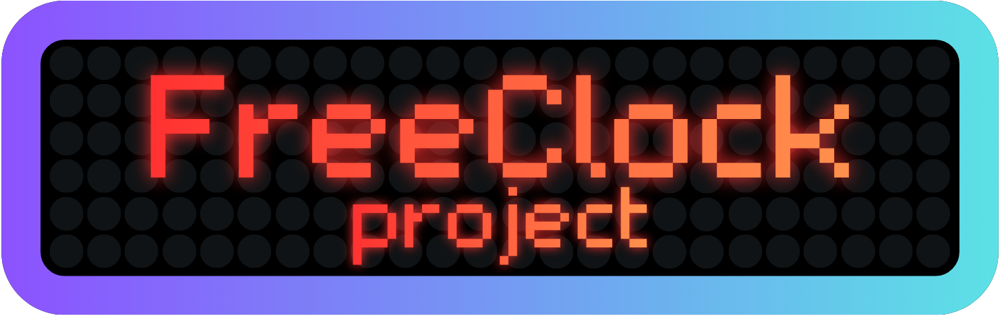

<div align= "center">

⭐ **Se ti piace questo progetto, metti una stella al repository!** ⭐ <br>
------- 🇬🇧 **[Readme in English][readme-en-url]** 🇬🇧 --------

<hr />
</div>

<div align="center">
<h2>FreeClock Mobile</h2>

[](#)
[](#)
[](#)

<a href="https://play.google.com/store/apps/details?id=net.luigirossi.freeclock">
  
</a>
&nbsp;&nbsp;


<hr/>

<a href="https://github.com/Matese-Makers/FreeClock">

</a>

<p><em>Questo software fa parte del progetto <a href="https://github.com/Matese-Makers/FreeClock"><strong>FreeClock</strong></a> — un orologio smart open source facile da assemblare, con un guscio stampabile in 3D e un'app mobile per la gestione. Costruiscilo anche tu ed entra a far parte del progetto!</em></p>

</div>

## 💡 Overview

FreeClock Mobile è l'app companion per configurare e gestire il dispositivo **FreeClock ESP32** via **Bluetooth Low Energy (BLE)**.\
Permette di eseguire il pairing iniziale, configurare tutti i moduli del display, aggiornare il firmware e ricevere le news del progetto — tutto dal proprio smartphone.

### 🌍 Supporto Multilingua
- 🇮🇹 Italiano (lingua predefinita)
- 🇬🇧 Inglese
- 🔄 Cambio lingua in-app con `@ngx-translate/core`
- 🔗 News e contenuti caricati nella lingua corrente via API

### 📱 Wizard di Configurazione Iniziale
- 👋 Schermata di benvenuto
- 📡 Scansione automatica dispositivi BLE nelle vicinanze
- 🔐 Pairing con PIN a 6 cifre (mostrato sul display del dispositivo)
- 📶 Configurazione rete WiFi con scansione reti disponibili
- 🌍 Selezione fuso orario
- ✅ Schermata di completamento

### 🏠 Home & News
- 📋 Lista dispositivi associati con accesso rapido
- 📰 Feed news del progetto FreeClock (da API FreeClock Manager)
- 📄 Dettaglio news con immagini e contenuto completo
- 🔄 Pull-to-refresh per aggiornamento news
- 🔔 Push notification via Firebase Cloud Messaging

### ⚙️ Impostazioni Dispositivo
- 🛠️ **Generali** — configurazione di base del dispositivo
- 📶 **WiFi** — gestione connessione wireless
- 🖥️ **Display** — luminosità e parametri schermo
- ⏰ **Ora & Meteo** — fuso orario, città meteo con ricerca OpenWeatherMap
- 📰 **News** — configurazione modulo news sul display
- 🏷️ **Brand** — personalizzazione testo/logo
- 💬 **Citazioni & Quiz** — configurazione frasi e indovinelli
- 🎵 **Jukebox** — configurazione modulo audio
- 🔄 **Aggiornamento Firmware** — verifica e aggiornamento OTA
- ℹ️ **Info Dispositivo** — dettagli hardware e firmware

### 🔗 Comunicazione BLE
- 📡 Scansione dispositivi con filtro per Service UUID FreeClock
- 🔐 Autenticazione con PIN a 6 cifre
- 📖 Lettura/scrittura caratteristiche GATT per ogni modulo
- 🔔 Notifiche BLE in tempo reale per lo stato del dispositivo
- 🔁 Riconnessione automatica (fino a 3 tentativi) con feedback utente
- 🚫 Gestione disconnessione con redirect automatico

### 📄 Pagina Info
- ℹ️ Pagina informativa con contenuto HTML localizzato (IT/EN)
- 🔗 Informazioni sul progetto FreeClock

### ⚙️ Stack Tecnologico
- 📱 Ionic 8 + Angular 20 (standalone components)
- ⚡ Capacitor 8 — Android + iOS
- 📡 `@capacitor-community/bluetooth-le` — comunicazione BLE
- 🌐 `@ngx-translate/core` v17 — i18n (Italiano + Inglese)
- 🔔 `@capacitor-firebase/messaging` — push notification via FCM
- 💾 `@capacitor/preferences` — storage locale dispositivi associati
- 🖼️ `@capawesome/capacitor-android-edge-to-edge-support` — supporto edge-to-edge Android

## 🚀 Getting Started

### Prerequisiti

- **Node.js 22+**
- **Ionic CLI** (`npm install -g @ionic/cli`)
- **Android Studio** (per build Android)
- **Xcode** (per build iOS, solo macOS)

### Installazione

1. **Clona il repository:**

   ```bash
   git clone https://github.com/luigirossidev/freeclock-mobile.git
   cd freeclock-mobile
   ```

2. **Installa le dipendenze:**

   ```bash
   npm install
   ```

### Sviluppo nel browser

> **Nota:** il BLE non è disponibile nel browser, utile solo per verifica UI/routing.

```bash
ionic serve
```

### Build Android

```bash
# Aggiungi la piattaforma (solo la prima volta)
npx cap add android

# Build e avvia su device fisico (richiesto per BLE)
ionic build
npx cap sync android
npx cap run android
```

L'APK di debug si trova in: `android/app/build/outputs/apk/debug`

### Build iOS

```bash
# Aggiungi la piattaforma (solo la prima volta)
npx cap add ios

# Build e avvia su device fisico
ionic build
npx cap sync ios
npx cap run ios
```

## 📂 Struttura progetto

```
src/app/
├── core/                       # Costanti, models, servizi
│   ├── constants/              # UUID BLE e costanti
│   ├── models/                 # DeviceConfig, PairedDevice
│   └── services/               # BLE, Storage, News, Weather, Push, Timezone
├── shared/                     # Componenti e pipe riutilizzabili
│   ├── components/             # ConnectionStatus, ModuleToggle, CitySelector, TimezoneSelector
│   └── pipes/                  # SignalStrength e altre pipe
├── wizard/                     # Setup iniziale (6 step)
│   ├── welcome/
│   ├── scan/
│   ├── pin/
│   ├── wifi-setup/
│   ├── timezone/
│   └── done/
├── main/                       # App principale (tabs)
│   ├── home/                   # Home con lista devices e news
│   │   └── news-detail/        # Dettaglio singola news
│   ├── devices/                # Gestione dispositivi
│   │   └── settings/           # 10 pagine impostazioni
│   │       ├── general/
│   │       ├── wifi/
│   │       ├── display/
│   │       ├── time-weather/
│   │       ├── news/
│   │       ├── brand/
│   │       ├── quote-quiz/
│   │       ├── jukebox/
│   │       ├── update/
│   │       └── device-info/
│   ├── info/                   # Pagina informativa
│   └── tabs/                   # Layout tab navigation
└── home/                       # Landing page iniziale
```

## 📱 Dispositivo compatibile

- **FreeClock ESP32** con firmware 2.0.0+
- Connessione BLE con PIN a 6 cifre (mostrato sul display LED)
- Service UUID: `FC000001-1234-5678-9ABC-DEFFREEC10C0`

## 🤝 Contribuire

I contributi sono benvenuti! Ecco come puoi aiutare:

1. **Fai il fork** del repository
2. **Crea** un branch per la tua feature (`git checkout -b feature/la-mia-feature`)
3. **Committa** le tue modifiche (`git commit -m 'Aggiunta la mia feature'`)
4. **Pusha** il branch (`git push origin feature/la-mia-feature`)
5. **Apri** una Pull Request

Assicurati che il codice segua lo stile esistente del progetto e che tutte le funzionalità siano correttamente funzionanti prima di inviare una PR.

Per segnalare bug o richiedere nuove funzionalità, [apri una issue](https://github.com/luigirossidev/freeclock-mobile/issues).

## 📄 Licenza

Questo progetto è rilasciato sotto la licenza **GNU Affero General Public License v3.0 (AGPL-3.0)**.

Questo significa che sei libero di usare, modificare e distribuire questo software, a condizione che:
- Qualsiasi versione modificata resa disponibile tramite rete deve essere rilasciata con la stessa licenza
- Il codice sorgente deve essere reso disponibile agli utenti che interagiscono con il software tramite rete

Per il testo completo della licenza, consulta il file [LICENSE](LICENSE).

<!--URL for Links-->
[readme-en-url]: README.md
[readme-it-url]: README.it.md
