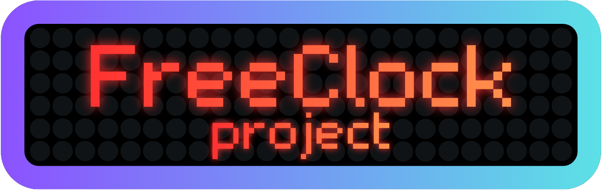

<div align= "center">

⭐ **If you like this project, give the repository a star!** ⭐ <br>
------- 🇮🇹 **[Readme in Italiano][readme-it-url]** 🇮🇹 --------

<hr />
</div>

<div align="center">
<h2>FreeClock Mobile</h2>

[](#)
[](#)
[](#)


<a href="https://play.google.com/store/apps/details?id=net.luigirossi.freeclock">
  
</a>
&nbsp;&nbsp;


<hr/>

<a href="https://github.com/Matese-Makers/FreeClock">

</a>

<p><em>This software is part of the <a href="https://github.com/Matese-Makers/FreeClock"><strong>FreeClock</strong></a> project — an open source smart clock, easy to assemble, with a 3D-printable shell and a mobile app for management. Build yours and join the project!</em></p>

</div>

## 💡 Overview

FreeClock Mobile is the companion app for configuring and managing the **FreeClock ESP32** device via **Bluetooth Low Energy (BLE)**.\
It allows you to perform the initial pairing, configure all display modules, update firmware, and receive project news — all from your smartphone.

### 🌍 Multi-language Support
- 🇮🇹 Italian (default language)
- 🇬🇧 English
- 🔄 In-app language switching with `@ngx-translate/core`
- 🔗 News and content loaded in the current language via API

### 📱 Initial Configuration Wizard
- 👋 Welcome screen
- 📡 Automatic BLE device scanning nearby
- 🔐 Pairing with 6-digit PIN (shown on the device display)
- 📶 WiFi network configuration with available network scanning
- 🌍 Timezone selection
- ✅ Completion screen

### 🏠 Home & News
- 📋 Paired devices list with quick access
- 📰 FreeClock project news feed (from FreeClock Manager API)
- 📄 News detail with images and full content
- 🔄 Pull-to-refresh for news updates
- 🔔 Push notifications via Firebase Cloud Messaging

### ⚙️ Device Settings
- 🛠️ **General** — basic device configuration
- 📶 **WiFi** — wireless connection management
- 🖥️ **Display** — brightness and screen parameters
- ⏰ **Time & Weather** — timezone, weather city with OpenWeatherMap search
- 📰 **News** — display news module configuration
- 🏷️ **Brand** — text/logo customization
- 💬 **Quotes & Quiz** — quotes and riddles configuration
- 🎵 **Jukebox** — audio module configuration
- 🔄 **Firmware Update** — OTA check and update
- ℹ️ **Device Info** — hardware and firmware details

### 🔗 BLE Communication
- 📡 Device scanning with FreeClock Service UUID filter
- 🔐 Authentication with 6-digit PIN
- 📖 GATT characteristics read/write for each module
- 🔔 Real-time BLE notifications for device status
- 🔁 Automatic reconnection (up to 3 attempts) with user feedback
- 🚫 Disconnection handling with automatic redirect

### 📄 Info Page
- ℹ️ Informational page with localized HTML content (IT/EN)
- 🔗 FreeClock project information

### ⚙️ Tech Stack
- 📱 Ionic 8 + Angular 20 (standalone components)
- ⚡ Capacitor 8 — Android + iOS
- 📡 `@capacitor-community/bluetooth-le` — BLE communication
- 🌐 `@ngx-translate/core` v17 — i18n (Italian + English)
- 🔔 `@capacitor-firebase/messaging` — push notifications via FCM
- 💾 `@capacitor/preferences` — local storage for paired devices
- 🖼️ `@capawesome/capacitor-android-edge-to-edge-support` — Android edge-to-edge support

## 🚀 Getting Started

### Prerequisites

- **Node.js 22+**
- **Ionic CLI** (`npm install -g @ionic/cli`)
- **Android Studio** (for Android builds)
- **Xcode** (for iOS builds, macOS only)

### Installation

1. **Clone the repository:**

   ```bash
   git clone https://github.com/luigirossidev/freeclock-mobile.git
   cd freeclock-mobile
   ```

2. **Install dependencies:**

   ```bash
   npm install
   ```

### Browser Development

> **Note:** BLE is not available in the browser, useful only for UI/routing verification.

```bash
ionic serve
```

### Android Build

```bash
# Add the platform (first time only)
npx cap add android

# Build and run on a physical device (required for BLE)
ionic build
npx cap sync android
npx cap run android
```

The debug APK can be found at: `android/app/build/outputs/apk/debug`

### iOS Build

```bash
# Add the platform (first time only)
npx cap add ios

# Build and run on a physical device
ionic build
npx cap sync ios
npx cap run ios
```

## 📂 Project Structure

```
src/app/
├── core/                       # Constants, models, services
│   ├── constants/              # BLE UUIDs and constants
│   ├── models/                 # DeviceConfig, PairedDevice
│   └── services/               # BLE, Storage, News, Weather, Push, Timezone
├── shared/                     # Reusable components and pipes
│   ├── components/             # ConnectionStatus, ModuleToggle, CitySelector, TimezoneSelector
│   └── pipes/                  # SignalStrength and other pipes
├── wizard/                     # Initial setup (6 steps)
│   ├── welcome/
│   ├── scan/
│   ├── pin/
│   ├── wifi-setup/
│   ├── timezone/
│   └── done/
├── main/                       # Main app (tabs)
│   ├── home/                   # Home with device list and news
│   │   └── news-detail/        # Single news detail
│   ├── devices/                # Device management
│   │   └── settings/           # 10 settings pages
│   │       ├── general/
│   │       ├── wifi/
│   │       ├── display/
│   │       ├── time-weather/
│   │       ├── news/
│   │       ├── brand/
│   │       ├── quote-quiz/
│   │       ├── jukebox/
│   │       ├── update/
│   │       └── device-info/
│   ├── info/                   # Informational page
│   └── tabs/                   # Tab navigation layout
└── home/                       # Initial landing page
```

## 📱 Compatible Device

- **FreeClock ESP32** with firmware 2.0.0+
- BLE connection with 6-digit PIN (shown on the LED display)
- Service UUID: `FC000001-1234-5678-9ABC-DEFFREEC10C0`

## 🤝 Contributing

Contributions are welcome! Here's how you can help:

1. **Fork** the repository
2. **Create** a branch for your feature (`git checkout -b feature/my-feature`)
3. **Commit** your changes (`git commit -m 'Add my feature'`)
4. **Push** the branch (`git push origin feature/my-feature`)
5. **Open** a Pull Request

Make sure the code follows the existing project style and that all features are working properly before submitting a PR.

To report bugs or request new features, [open an issue](https://github.com/luigirossidev/freeclock-mobile/issues).

## 📄 License

This project is released under the **GNU Affero General Public License v3.0 (AGPL-3.0)**.

This means you are free to use, modify, and distribute this software, provided that:
- Any modified version made available over a network must be released under the same license
- The source code must be made available to users who interact with the software over a network

For the full license text, see the [LICENSE](LICENSE) file.

<!--URL for Links-->
[readme-en-url]: README.md
[readme-it-url]: README.it.md
